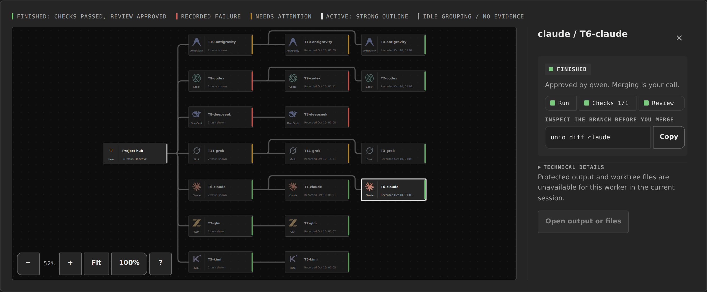
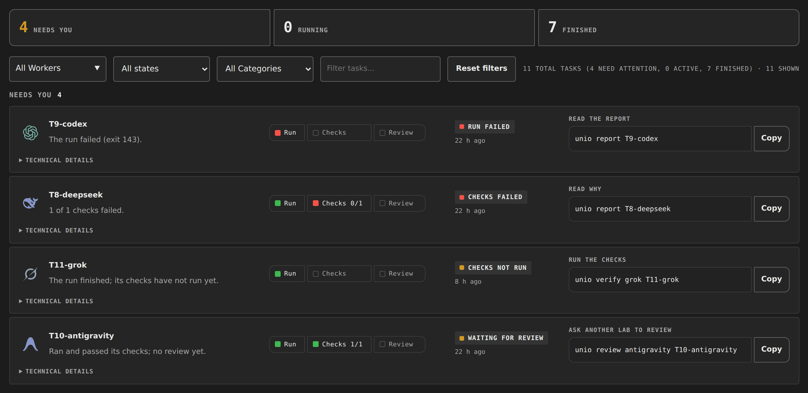
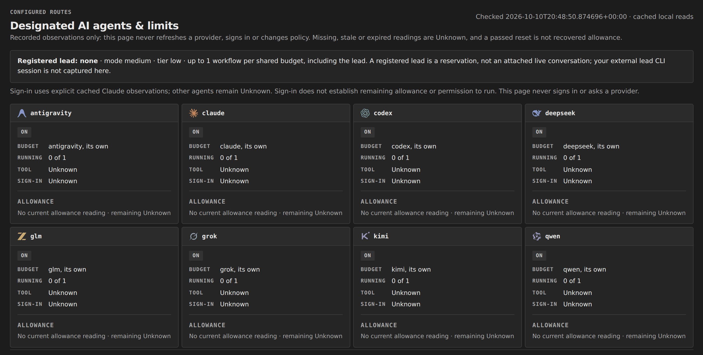
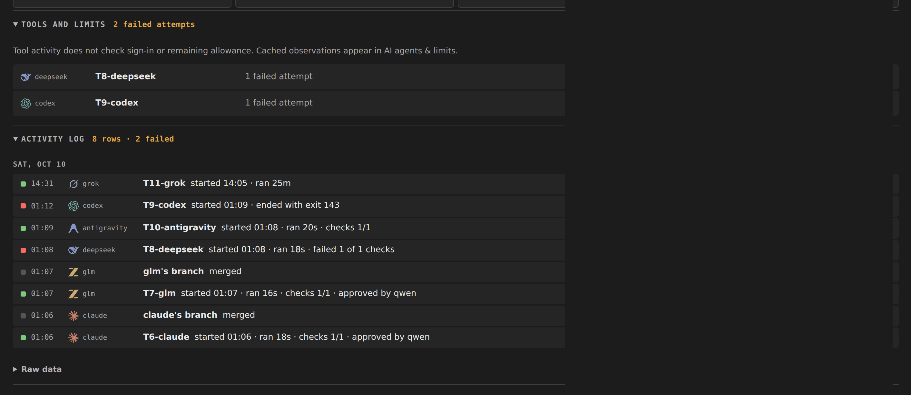

# Unio — Your AIs, in sync.

Unio brings AI agents from different AI labs together to build and improve
your project. A lead delegates the work, other agents review the changes,
and you stay in control.



## What Unio Does

- **Bring your AI agents into one team.** Connect agents from different AI
  labs through tools such as Claude Code, Codex, Grok, Antigravity and
  OpenCode. Give them a shared workspace for your project.
- **Give one AI agent the lead.** The lead turns your goal into manageable
  tasks, chooses workers and delegates the work. It coordinates their next
  steps within the plan you have approved.
- **Work on several tasks at once.** Workers can build separate parts of
  the project in parallel, each in its own copy. The lead moves independent
  tasks forward while other workers are busy, keeps related tasks in order
  and brings their results together for review.
- **Strengthen code and security with worker reviews.** AI agent workers
  from different AI labs can check one another's changes independently.
  Multiple review rounds help find bugs, security issues and ways to improve
  the code and product before you accept the work.
- **See what is finished and what needs attention.** Keep tasks, progress,
  checks and review findings together. See which changes passed their
  checks and which still need fixes or a decision.
- **Carry work forward when limits interrupt.** Clear handoffs record
  completed work, checks and next steps. The lead can pass the next task
  to another available agent when a session ends or an agent reaches its
  usage limit, reducing the need to explain the project again.
- **Keep control from start to finish.** You set the direction and decide
  how much freedom the lead has. Pause new work when needed, ask for changes
  and choose what becomes part of your project.

Read [how Unio assigns model roles](docs/ai/MODEL-ROLES.md): main implementation
agents build the features; verified-free workers handle routine support. Read
[how the lead keeps work moving](docs/development/PARALLEL-WORK.md): low tier
allows one workflow per shared account, while independent accounts work together.
The [agent fleet guide](docs/development/AGENT-FLEET.md) maps approved accounts
to implementation, research and routine work, including Copilot Free / Balanced.
The [model scoreboard](docs/development/MODEL-SCOREBOARD.md) helps it choose
workers from actual project results. The [bounded escalation guide](docs/ai/LEAD-ESCALATION.md)
explains how to preserve unfinished work and choose a correction route when
a worker cannot finish, following your project instructions.

**Available today:** a command-line tool for Linux, including Windows
through WSL, with a local browser dashboard for tasks, worker output and files.
Install [the latest stable release, Unio 0.5.20](https://github.com/danielmevit/unio/releases/tag/v0.5.20).
See [the changelog](CHANGELOG.md) for release history.

### Tools for everyday work

- **Plan and delegate.** Explain dependencies and file conflicts with the
  [task planner](docs/TASK-PLAN.md), then start an
  [explicitly approved task](docs/TASK-DISPATCH.md).
- **Follow the team.** The [browser dashboard](bridge/README.md) brings together
  the work map, task filters, live worker output and activity history.
  [Fleet status](docs/FLEET-STATUS.md) shows shared-account slots and recorded
  allowance readings; missing or stale readings stay Unknown.
- **Review changes independently.** Collect [reviews in parallel](docs/REVIEW-COLLECTION.md)
  and inspect [structured findings](docs/REVIEW-FINDINGS.md), preserving each
  reviewer's evidence and disagreement. Reviews leave acceptance with you.
- **Preserve unfinished work.** [Recovery saves](docs/WORK-SAVING.md) keep local
  snapshots before, during and after worker runs, with inspection, restore
  and separately authorized continuation. Saves are not off-device backups.
- **Protect shared subscription budgets.** [Lead-budget consent](docs/development/LEAD-BUDGET-CONSENT.md)
  requires explicit permission before a worker spends the lead's declared account.
  It preserves concurrency limits and does not create extra allowance.
- **Save eligible failed work as a commit.** Enable [WIP preservation](docs/WORK-WIP.md)
  before a run. It commits scoped, supported changes after confirmed cleanup,
  keeping the failed result and leaving acceptance with you.
- **Understand worker stops.** [Plain outcomes](docs/WORKER-OUTCOMES.md) explain
  supported adapter results; missing or unsupported evidence stays Unknown.
- **Control publication destinations.** Opt into [remote policy](docs/REMOTE-POLICY.md)
  to separate development and release pushes, while preserving owner hooks.
- **Choose your workflow.** Set YOLO, Balanced or Thorough review, choose
  reasoning effort, and control concurrency per shared account. See
  [the independent workflow choices](#choose-how-unio-works).
- **Use the right worker.** [Packaged integrations](docs/development/AGENT-FLEET.md)
  connect implementation agents and research/proposal tools. A
  [local command audit](docs/WORKER-CONNECTIONS.md) helps catch setup problems;
  [task experience](docs/MODEL-EXPERIENCE.md) records checked outcomes to guide
  future assignments.

Open the dashboard from your project:

```bash
unio dashboard ensure --open-browser
```

It prints the local link and reuses a running dashboard. The dashboard is
read-only by default and stays up until `unio dashboard stop`; closing it
does not stop workers. Ask your lead to run this command at session startup
so you can follow the work. It does not attach or record an existing AI chat.

[Lead cooldown restart](docs/LEAD-COOLDOWN.md) is experimental and must be
explicitly enabled. Its genuine subscription-limit-to-restart cycle remains
unverified.

[Everyday use](docs/DAILY-USE.md) · [A look around](#a-look-around) · [Step by step](#a-task-step-by-step) · [Try it free](#try-it-free-no-ai-calls) ·
[FAQ](#faq) · [Under the hood](#for-the-curious-and-the-nerdy) ·
[What's next](#whats-next)


## A look around

The [website](https://danielmevit.github.io/unio/) runs the real dashboard on
a demo project that you can drag, zoom and click.

**What needs you.** Every task with its run, checks and review, its state and
the next command to copy.



**Who works on what.** Every configured AI agent, its budget and what it is
running. What the page cannot confirm stays Unknown.



**What happened.** Failed attempts, and one row per task run: started, ran,
checked, reviewed and merged.



These screenshots show the demo project. On your computer, `unio dashboard`
opens the same view of your own work.


## A task, step by step

Say you want to add search to a small website:

1. **Describe it** to the lead AI: "Help people find an article by title."
2. **Approve the plan.** The lead splits the work into small tasks and says
   who does each one, which files may change, and how it will be checked.
3. **The helpers work**, each in a separate copy of the project, so their
   changes never get mixed up.
4. **The work is checked.** Unio runs the agreed checks and keeps
   the evidence. An agent from another AI lab can review the changes too.
5. **You decide.** Keep the changes, ask for fixes, or drop them. A
   finished AI run is not proof the work is right; the checks and your
   review are.


## Good to know

- Optional [subscription adapters](docs/integrations/README.md) connect
  Mistral Vibe workers and Perplexity Pro research. Perplexity can research a
  task and propose code; an implementation agent reviews the proposal, makes
  suitable changes and tests them. The installer packages both adapter scripts;
  they require their own installed, signed-in tools and explicit configuration.
- Unio does not get around usage limits or pool subscriptions. Each
  tool keeps its own plan, limits, and terms.
- Switching AIs after a limit is supervised today: the next AI gets a
  written handoff, not the previous one's memory. Automatic continuation
  is on the roadmap.
- Helper AIs can run commands on your computer, and separate project copies
  are not a security sandbox. Use a spare Linux machine or virtual machine
  without important passwords or keys.
- AI tools send your prompts and code to their providers. Keep secrets out
  of tasks and repositories.


## Try it free (no AI calls)

### 1. Install and rehearse

You need Linux or WSL with Bash, Git, Python 3, and standard tools such as
`flock`. The rehearsal needs no AI account and uses no AI allowance.

```bash
git clone https://github.com/danielmevit/unio.git
cd unio
bash unio-install.sh
export PATH="$HOME/.local/bin:$PATH"
unio selftest
```

The self-test runs the whole workflow with pretend AIs in a temporary
project. The command is `unio`. The
installer puts commands in `~/.local/bin` and settings in
`~/.config/unio`; the [setup guide](docs/SETUP.md) shows how to keep the
PATH change for future terminals.

### 2. Choose your path

- **Already installed:** [open your project and follow everyday work](docs/DAILY-USE.md).
- **Let my AI coordinate:** [start with your AI](#start-with-your-ai).
- **Show me the whole idea:** [take the worked-example tour](docs/EXAMPLE.md).
- **Walk me through setup:** [follow the complete guide](docs/GUIDEBOOK.md),
  including signing in to your AI tools.
- **I know terminals:** [use the compact setup reference](docs/SETUP.md).

### 3. Your first real task

Install and sign in to at least one AI coding tool. The included settings
cover Claude Code, Codex, Antigravity, OpenCode, and Grok; use the ones you
have. Then try a project you do not mind experimenting on, for example
with Codex:

```bash
# Use your own Git repository URL; it needs at least one commit.
unio new YOUR_REPOSITORY_URL my-project codex
cd my-project/repo
unio doctor
unio agents
```

Next, [start your lead AI](#start-with-your-ai) in `my-project/repo`.

Start with one helper and add another when you want a second perspective.
`agents` shows what is installed, not remaining quota or sign-in status.
`smoke` makes real test calls, so it uses some of your allowance.

 If your AI tool keeps asking before each `unio` command, or its own
 safety system refuses to run them, [allow those commands once](docs/SETUP.md#9-lead-ai-permissions)
 instead of switching its safety checks off. Unio's own refusals,
 such as `STOP is active`, say why in their message.


## Start with your AI

Building something new from scratch? Use the
[new-project prompt](docs/ai/NEW-PROJECT-PROMPT.md): open an empty folder,
describe your idea, and let your lead set up Unio and coordinate the workers.
You do not need an existing repository or a clone of Unio's source.
Choose a complete startup protocol:
[YOLO](docs/ai/NEW-PROJECT-PROMPT.md#yolo-prompt),
[Balanced](docs/ai/NEW-PROJECT-PROMPT.md#balanced-prompt), or
[Thorough](docs/ai/NEW-PROJECT-PROMPT.md#thorough-prompt).
They range from focused checks and lead review to two independent reviews
from different AI labs, followed by the lead's assessment. All keep the
coordination budget separate from the work mode.
Choose **Low / Medium / Max reasoning effort** separately from the protocol
and account tier. Every [startup prompt](docs/ai/NEW-PROJECT-PROMPT.md#choose-reasoning-effort-independently)
has editable fields; you can change any one later while keeping the others.

Open your AI coding CLI in your project's `repo/` folder. Choose a capable
lead, such as Claude Code, Codex, Antigravity/Gemini or Mistral Vibe, and
paste this prompt followed by the task you want done:

```text
Lead this project using Unio. Read AGENTS.md and MASTER.md if present,
then docs/ai/START_HERE.md or ../coord/docs/LEAD-ROUTING.md.
Read this project's handoff and coordination log if they exist.
If Unio is not initialized here, inspect the layout and help me set up
this project's own workspace without overwriting existing work.
Check the local setup and preserve my chosen review protocol, reasoning
effort and coordination tier. For a new project, default to Low reasoning
and low coordination tier. I can change any one independently for future
assignments; record my choice in the project instructions and handoff.
Workers sharing your model or subscription start at low effort where supported.
Increase it gradually from task evidence, preserving attempts and retry rules.
Track results by route, model and effort.
Register your configured lead alias for this project. Do not replace an active lead.
Open the managed dashboard and show me its link.
For the task I give you, estimate the time, delegate through Unio,
verify the changes and keep me updated. Preserve work and leave a clear
handoff. Answer my status questions briefly and continue the authorized work;
stop when I ask or when a real blocker requires it. Ask only for missing
decisions or authority.
```

You start the conversation; the lead uses Unio to coordinate the workers.
Typing `unio` shows command help. `unio lead` records the lead's budget
reservation; it does not launch an AI or transfer a conversation.

Starting another project? Open a new terminal in that project's workspace
and use the prompt above with its own task. Your other AI sessions can stay
open. Each project has its own lead reservation, tasks and dashboard; see
[separate project sessions](docs/ai/START_HERE.md#start-a-separate-project-session).

Replacing the lead on an existing project? Finish that lead's work and
handoff first, then start the new CLI in the same folder. The
[AI startup guide](docs/ai/START_HERE.md#switch-to-a-different-lead)
explains the checks, lead registration and shared-account limits. Your
task files, results and handoffs stay in the workspace.


## Choose how Unio works

Three independent choices control the workflow. Start with **Low reasoning
effort** and **low coordination tier**, then change either when needed.

| Choice | Options | What changes |
| --- | --- | --- |
| **Review protocol** | YOLO / Balanced / Thorough | The depth of checks and independent reviews. |
| **Reasoning effort** | Low / Medium / Max | How the lead chooses supported reasoning settings for itself, workers and reviewers. |
| **Coordination tier** | low / medium / high | 1 / 2 / 4 independent workflows per shared account, including the lead. |

Use `yolo`, `balanced` and `thorough` for the review protocol. The older
`medium` and `safe` aliases remain supported.
See the [work modes guide](docs/WORK-MODES.md).

```bash
unio mode yolo
unio mode balanced
unio mode thorough
unio tier low                     # account concurrency; separate from reasoning effort
unio lead codex                   # register the lead reservation in its budget group
unio account opencode go-primary  # aliases sharing one budget
unio policy                       # current state (--json for machines)
```

### Low / Medium / Max reasoning effort

- **Low — default:** workers sharing the lead model or subscription start at
  the lowest supported effort; other routes use their approved defaults. Raise
  effort gradually from checked results, with max off.
- **Medium:** let the lead adjust effort to difficulty, including supported
  xhigh/max for hard reasoning and lower settings for routine work.
- **Max:** request each model route's highest permitted, verified supported
  effort for every new controllable assignment.

These are lead instructions, with model-specific controls explained in the
[reasoning guide](docs/ai/REASONING-PROFILES.md); there is no `unio effort`
command yet. Change the prompt's **Reasoning effort** field or tell the lead:

```text
Keep Balanced review and low coordination tier. Switch reasoning effort to
Medium for future tasks, using supported max only when difficulty warrants it.
```

Any combination works: YOLO + Max and Thorough + Low are valid. Changes apply
to new assignments; existing runs keep their settings and evidence. The lead
must remember your choice, preserve the other settings and explain any route
that cannot change effort. Higher effort or concurrency never adds quota or
authorizes extra token charges.

Mode and tier let you choose the pace and protect shared subscription
budgets. Unio counts its native worker and review workflows and the
registered lead. Sessions launched outside Unio remain uncounted.

New projects include instructions for the lead to read the active policy before
delegating. Verified-free OpenCode models handle routine support; they never
become the lead, main feature owner or final approver.

### Manual allowance tracking

`unio capacity` keeps a local record of the remaining allowance you saw for
each shared budget group, with its age and optional reset time. You type the reading; Unio never asks a provider. Inside a
workspace it uses that project; elsewhere pass `--project PATH`.

```bash
unio capacity record --group codex --window five-hour --window-minutes 300 \
    --remaining-percent 42 --observed-at 2026-10-09T14:00:00+02:00 \
    --reset-at 2026-10-09T17:30:00+02:00
unio capacity show --group codex   # --json for machines
```

Only a fresh reading (default: under 15 minutes old) counts as usable. A
missing, stale, expired or invalid reading shows as Unknown, never as 100%.
A passed reset is not proof of a refill: record a new reading. Other clients
can spend the same budget. Details: [manual capacity readings](docs/development/CAPACITY-READINGS.md).

Codex has an optional automatic allowance source. You run it explicitly;
neither the browser nor `show` ever starts it:

```bash
unio capacity refresh codex --group codex   # one read-only metadata request
unio capacity show --provider codex          # local cache only
```

The refresh asks the installed `codex app-server` for account and rate-limit
metadata only: no model turn, login or token refresh. It stores the 5h and
weekly windows separately from your manual readings. A failed refresh turns
that group Unknown and keeps the earlier reading as history only. Other
providers stay manual or Unknown.


## FAQ

<details>
<summary>Do I have to pay for anything extra?</summary>

No. Unio is free and open source. It works with the AI plans you
already have, each signed in its own way, so you need no separate API keys.
The rehearsal (`unio selftest`) makes no AI calls at all. Real tasks use
your plans' normal allowance; optional extras, such as a second AI reviewing
the work, use a little more.

</details>

<details>
<summary>How is this different from calling the AI tools myself?</summary>

You can call any AI tool directly, and for a quick question that is fine.
Unio matters once AIs change your code:

| | Calling AI tools directly | Through Unio |
|---|---|---|
| Where the AI works | Wherever you point it; two at once can collide | Its own copy on its own branch |
| When it is "done" | When the AI says so | When the task's checks pass and only allowed files changed |
| Failures | Easy to miss | Recorded: a run that timed out stays "failed" |
| Reviews | An opinion | Tied to the exact version; a later change makes it stale |
| Memory | Lives in one chat | Files any AI or person can read and continue from |
| Safety | Each tool on its own | A stop switch, paused agents, one run per worker, time limits |

The AIs were always reachable. Unio makes their work isolated,
checked, recorded and easy to hand over.

Leads should read the [routing and spending policy](docs/development/LEAD-ROUTING.md)
and [model effort guide](docs/development/MODEL-EFFORT.md) before assigning work.

</details>

<details>
<summary>Which AI tools do I need?</summary>

One is enough to start. Settings are included for Claude Code, Codex,
Antigravity, OpenCode (for models such as GLM and Kimi) and Grok. Any
command-line AI that can take a task without a chat window can join with
one line in `~/.config/unio/agents.conf`, for example
`mycli=mycli -p "$(cat "$TASKFILE")"`. Prefer a supported stdin or file
option for large tasks; see the [transport guidance](docs/SETUP.md). An
agent from another AI lab can review the work independently.

</details>

<details>
<summary>Does it work on Windows or Mac?</summary>

Linux, yes. Windows, yes, through WSL (Ubuntu works well). Mac is not
supported yet: Unio relies on Linux tools such as `flock`.

</details>

<details>
<summary>Do the AIs talk to each other?</summary>

Not directly, and they share no memory. They coordinate through files in
your project: task orders, reports, results and handoff notes. Each AI
starts fresh, reads what the others left, and writes down what it did, so
another AI can continue from those notes.

</details>

<details>
<summary>Is it safe? Will it change my project without asking?</summary>

Helpers are given their own copies on their own branches, and their work
reaches your main branch when you merge it. The lead AI works in your main
copy, so tell it not to merge for you (the starter prompt above does).
Nothing enforces those boundaries, though: every AI runs commands on your
computer with your rights, and the copies are not a security sandbox. Use
a spare Linux machine or virtual machine without important passwords or
keys, keep secrets out of tasks and repositories, and remember that each AI
sends your prompts and code to its provider. `unio stop` blocks new runs;
`unio kill T7` ends task T7 if it is running.

</details>

<details>
<summary>How do I know the AI's work is actually right?</summary>

Every task names the files it may change and the checks that must pass.
`unio verify` re-runs those checks and fails the task if one fails or
anything changed outside the allowed files; nothing is undone, so you can
inspect it. Once verify passes, `unio review` can ask an agent from another AI lab
to judge the committed change. The result records separately whether the
AI finished, the checks passed and the review approved. Your own decision
comes last: a finished run is never taken as proof the work is right.

</details>

<details>
<summary>What happens when an AI hits its usage limit?</summary>

Pause it and give the next task to an agent from another AI lab.
`unio off codex 5h` stops new tasks from going to Codex for five hours,
and `unio handoff codex T7` writes a context note about task T7: what
was done, what passed and what is left. The lead then gives the work to
another AI with that note. The note is context only: unfinished, uncommitted
changes stay in Codex's copy. [Handoff packets](docs/QUALITY-USAGE.md#handoff-packets)
explain the details. Unio does not get around limits or share plans;
each tool keeps its own. Unio includes
[automatic recovery saves](docs/WORK-SAVING.md) before, during and after native
worker runs, plus manual restore. These preserve unfinished files without a
final AI answer. It also supports one separately authorized task from an
exact restored save, with account limits and replay protection. An owner-enabled
[lead cooldown supervisor](docs/LEAD-COOLDOWN.md) is experimental for the
supported Codex CLI. Its automated checks passed, but a genuine lead usage
limit followed by automatic restart remains unverified. It is disabled until
explicitly enabled. Worker limit handling stays unchanged.
See the [current recovery validation](docs/development/RECOVERY-ACCEPTANCE-2026-10-08.md)
for completed checks and the remaining live cooldown validation.

</details>

<details>
<summary>My lead AI keeps asking for permission, or a run is refused. What now?</summary>

First check who refused. Unio's own refusals say why, for example
`STOP is active`, an agent that is `OFF`, or a worker that is
`already running a task`; `unio status` shows the state. If instead the
AI tool asks or refuses, that is its own safety system. For Claude Code,
allow the `unio` commands once in a small settings file and
restart it; [setup step 9](docs/SETUP.md#9-lead-ai-permissions) shows the
file and what it does and does not allow. Other tools have similar approval
settings. Do not add rules for pushes or merges into your main branch;
approve those yourself, one at a time. Turning all safety checks off is
only sensible on a throwaway virtual machine.

</details>


## For the curious and the nerdy

Unio is a Bash orchestration layer around existing coding CLIs, not
a new model or a hosted service. Each tool uses its own sign-in; there is no
shared API-key service.

- **Separate workspaces:** each worker gets a Git worktree on an
  `agent/NAME` branch. A worktree shares the repository's history; it is not
  an isolated virtual machine.
- **Explicit task contracts:** Markdown task files hold instructions,
  allowed paths, validation commands, and a definition of done.
- **Inspectable evidence:** diffs, append-only reports, live logs, a JSONL
  event ledger, and a revision-bound JSON result per task.
- **Cross-provider options:** independent reviews, competing attempts, and
  rotating bug hunts. They use extra provider capacity and are optional.
- **Availability controls:** bench a provider by hand or for a set time.
  Limit-message detection flags failed runs; it is not a quota meter.

For a layered review workflow, the lead can assign several reviewers from
different AI labs to the same complete change. Run their reviews independently
and compare findings before deciding what needs a correction. Each native
review records a decision for the exact task, base and committed change;
a later edit makes that evidence stale. The tool provides these checks and
records, while the lead coordinates additional review rounds.

Reviewers can disagree or miss the same defect. Use executable checks and
inspect actual evidence alongside their findings. More calls consume more
allowance; bounded tasks and written handoffs help avoid repeated work, but
lower total usage depends on the results. Automatic checkpoint recovery and
universal multi-review enforcement are not shipped features.

Everyday commands once a project is set up:

```bash
unio help             # discover commands
unio status           # tasks, reports, review queue, running work
unio tail             # follow the latest run's log
unio score            # per-worker scorecard from the event ledger
unio result codex T7  # stored run/verify/review evidence as JSON
unio handoff codex T7 # context packet for the next AI, same checkout
unio agents --json    # local availability; no login or quota probe
unio off codex 5h     # bench a provider for your chosen interval
unio on codex         # make it available again
```

A finished process, passing checks, a reviewer's approval, and your own
acceptance are separate results. `verify` exits 2 (INCOMPLETE) when a task
has no scope or Validate lines, and `review` runs only after a current
passing `verify`. `stop` blocks new runs; `kill TASK_ID` ends a running one.
Every exit code and field is in the [quality reference](docs/QUALITY-USAGE.md).

### Find the right level of detail

| I want to… | Start here |
|---|---|
| Understand the workflow step by step | [Complete guide](docs/GUIDEBOOK.md) · [Word copy](docs/GUIDEBOOK.docx) |
| Look up commands or troubleshoot | [Handbook](docs/HANDBOOK.md) |
| See a worked example | [Replayable tour](docs/EXAMPLE.md) |
| Understand task contracts and coordination | [Agent protocol](docs/PROTOCOL.md) |
| Read the release notes | [Changelog](CHANGELOG.md) |
| Work on Unio itself | [Development index](docs/development/README.md) · [Maintainer handoff](docs/HANDOFF.md) · [Doc conventions](docs/DOC-CONVENTIONS.md) |
| Test the engine's guardrails | [Test plan](docs/TESTPLAN.md) · [Word copy](docs/TESTPLAN.docx) |
| Read the background research | [Architecture research](research/multi-agent-claude-review.md) · [Original plan](docs/MASTER-PLAN.md) |

Contributor checks, none of which call a live provider:

```bash
bash tools/quality-check.sh   # everything below plus selftest and ShellCheck
bash tests/unio-quality.sh
bash tests/unio-branding.sh
bash tests/unio-probes.sh
bash tools/check-docs.sh
```

CodeGraph is optional; an unindexed project stays unindexed. Pandoc is only
needed to rebuild the Word manuals with `tools/make-docx.sh`.


## What's next

The [roadmap](docs/development/ROADMAP.md) tracks planned work and its order:
more reliable recovery and lead-session continuity, scoped phone access,
then native desktop support for Windows and macOS. Planned features are
separate from the capabilities available today.

See [release history](CHANGELOG.md) for shipped changes, the
[UX direction](docs/UX-DIRECTION.md) for interface plans, and
[brand notes](docs/BRAND.md) for the visual identity.

Continuing development of Unio itself with another AI? Paste the prompt from
[continue-with-ai-prompt.md](docs/development/continue-with-ai-prompt.md) and follow the
[workspace rules](docs/development/WORKSPACE-RULES.md). The [M1 status](docs/M1-STATUS.md)
and [findings index](docs/RESEARCH-FINDINGS.md) hold the details.


## License

Unio is licensed under **AGPL-3.0-only**, with attribution and origin
terms under sections 7(b) and 7(c). Copyright (C) 2026
**Daniel Mitev**, publicly **Daniel Mevit (@danielmevit)**. See
[LICENSE](LICENSE) and [NOTICE](NOTICE), or run `unio license`.

Commercial use and compliant forks are allowed. Covered redistributed
derivatives must preserve the **Unio** name and original author
credit in the reused material or appropriate legal notices, identify
modified versions, and meet the license's
source-sharing requirements; modified network versions must offer source
to their remote users. Merely using the tool to build an independent
project does not place that project under AGPL.

Companies seeking permissions for proprietary integration can request a
separate paid agreement. The software comes without warranty, and liability
limits apply subject to applicable law. Read the
[licensing and commercial-use guide](docs/LICENSING.md) for details.


## Keywords

The idea in one line: **AI agents from different AI labs, coordinated in one workspace
to build, review and improve your project.** Working together here means
coordinated tasks and reviewed handoffs, not shared conversation memory.
The [plain-English workflow guide](docs/AI-TEAM-WORKFLOWS.md) explains which
patterns work today.

- **Subagents across providers:** subagents from different AI labs,
  multi-provider subagents, cross-vendor subagents, lead agent with
  subagents, delegate work to subagents, parallel subagents, subagent
  orchestration, Claude Code and Codex as subagents, AI coding agent fleet,
  orchestrator and worker agents.
- **AI teamwork in plain language:** make AI assistants work together, a
  team of AI helpers, coordinate AI agents from different AI labs, use
  several AI models on one project, one AI builds and another reviews,
  human-controlled AI collaboration.
- **Everyday goals:** build with AI on a budget, AI help for a side project,
  work with limited AI plans, handle AI usage limits, continue a project
  with another AI, review AI-generated changes.
- **One place to steer the team:** glue AI tools together, control several
  AIs from one console, one command center for different AI providers,
  coordinate Claude Code and Codex.
- **Ways of working:** split work between AI helpers, run tasks in
  parallel, pass a task from one AI to the next, compare two AI solutions,
  ask an AI to find bugs, supervise a team of agents.
- **People and projects:** learners, hobby projects, independent makers,
  designers building software, solo developers, small teams, indie apps.
- **Technical terms:** multi-agent orchestration, multi-agent collaboration,
  AI agent teams, multi-model workflow, heterogeneous agents, cross-provider
  coding agents, human-in-the-loop AI, Git worktrees, CLI orchestration,
  task delegation, agent review, validation gates, quota-aware coordination.
- **Related ideas, not all implemented:** supervisor–worker workflows,
  writer–reviewer pipelines, agent relay, best-of-N, cross-provider handoff,
  agent swarms, AI councils. Not model merging, shared quotas, or automatic
  consensus.
- **Names and commands:** Unio, unio, Claude Code, Codex, Antigravity,
  OpenCode, Grok, Kimi.
