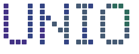
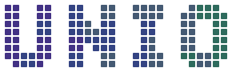

# Unio brand kit


The logos, dot lines and story behind Unio's look. The full guide (name,
voice, typography, colors and UI rules) is
[docs/BRAND.md](../BRAND.md#visual-identity).

## What the dots mean

Unio's logo is the word UNIO drawn in dots, and every part of it stands for
how Unio works.

- **A dot is one task.** One small, checked piece of work, done by one AI
  agent.
- **A letter is a group of tasks that belong together.** A dot alone means
  little; side by side, dots make a shape you can read.
- **The word is the project.** Tasks from agents of different AI labs, the
  lead, the workers and the reviewers, form one result together. No single
  dot is the word.
- **The colors are the AIs.** Each agent tone stands for an agent from a
  different lab. In the animated logo and the website's titles the tones flow
  through the word as a wave: agents come in, hand over and move on, and the
  word stays whole. That is the idea behind Unio: your AIs, in sync.
- **The dim dots are the plan.** Before the logo lights up, every dot is
  already there, dim: the planned work. The dots light up as the work gets
  done.

## Folders

| Folder | What is in it |
| --- | --- |
| `logo/single/` | The logo with strokes one dot wide, as in the font. The website and the README use it. |
| `logo/double/` | The same word with strokes two dots wide: every dot grown to a 2 × 2 block. Bolder, for larger or busier places. |
| `patterns/` | Dot lines for breaking up long pages: one clear line and five with stray dots, each also mirrored. |
| `legacy/` | The earlier dot-matrix U, still the website's favicon and the dashboard's loading screen. |

## Logo

Both `logo/single/` and `logo/double/` hold the same six files. The names say
which background they serve: `_light` for light mode, `_dark` for dark mode.

| File | What it is |
| --- | --- |
| `unio-logo_light.svg` / `unio-logo_dark.svg` | One ink: dark dots for light backgrounds, soft off-white dots for dark ones. Use when color would distract. |
| `unio-logo_tones-light.svg` / `unio-logo_tones-dark.svg` | The agent tones, a still moment of the wave. The light version uses the deeper tones, which read on white. |
| `unio-logo_animated-light.svg` / `unio-logo_animated-dark.svg` | The dots grow in as a ring from the top-left, then the tones flow through the word without end. Still for people who turn animation off. |

Single and double, in the agent tones, on light:




## Dot lines

A line drawn like a stroke of Doto: one row of dots in the agent tones, and,
here and there, a dot or a short dash above or below it. Like the logo, it is
animated: the dots grow in from the left, then the tones flow along the line
without end (still for people who turn animation off). `line-clear.svg` is
the plain line; `line-1.svg` to `line-5.svg` carry the stray dots, and each
`-mirrored` version is the same line flipped left to right, so there are
eleven in all. Put one between sections of a long page and don't repeat a
line on the same page.




## Making them

Every SVG here except the U in `legacy/` is drawn by
[tools/make-brand-assets.py](../../tools/make-brand-assets.py) from the Doto
font. It reads each dot's place on the letter's grid and draws an even
rounded square at 80 % of the dot spacing, the same way the website draws its
titles.

```sh
cd site && npm install && cd ..
python3 tools/make-brand-assets.py
```

It needs Python's `fontTools`. The lettering is
[Doto](https://github.com/oliverlalan/Doto), © The Doto Project Authors,
under the SIL Open Font License 1.1.
