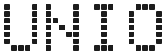
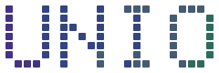
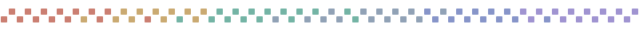
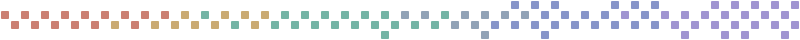

# Unio brand kit


The logos, patterns and story behind Unio's look. The full guide (name,
voice, typography, colors and UI rules) is
[docs/BRAND.md](../BRAND.md#visual-identity).

## What the dots mean

Unio's logo is the word UNIO drawn in dots, and every part of it stands for
how Unio works.

- **A dot is one task.** One small, checked piece of work, done by one AI
  agent.
- **A letter is a group of tasks that belong together.** A dot alone means
  little; side by side, dots make a shape you can read.
- **The word is the project.** Tasks from agents of different AI labs, the
  lead, the workers and the reviewers, form one result together. No single
  dot is the word.
- **The colors are the AIs.** Each agent tone stands for an agent from a
  different lab. In the animated logo and the website's titles the tones flow
  through the word as a wave: agents come in, hand over and move on, and the
  word stays whole. That is the idea behind Unio: your AIs, in sync.
- **The dim dots are the plan.** Before the logo lights up, every dot is
  already there, dim: the planned work. The dots light up as the work gets
  done.

## Logo

The file names say which background they serve: `_light` for light mode,
`_dark` for dark mode.

| File | What it is |
| --- | --- |
| `unio-logo_light.svg` / `unio-logo_dark.svg` | One ink: dark dots for light backgrounds, soft off-white dots for dark ones. Use when color would distract. |
| `unio-logo_tones-light.svg` / `unio-logo_tones-dark.svg` | The agent tones, a still moment of the wave. The light version uses the deeper tones, which read on white. |
| `unio-logo_animated-light.svg` / `unio-logo_animated-dark.svg` | The dots grow in as a ring from the top-left, then the tones flow through the word without end. Still for people who turn animation off. Used at the top of the README. |

One ink and the agent tones, on light:




## Patterns

Dot bands that break up long pages such as the README: two checkerboard rows
in the agent tones, flowing from one end to the other.

| File | Pattern |
| --- | --- |
| `pattern-odd.svg` | The first row starts on the 1st square (1st, 3rd, 5th ...), the second row on the 2nd. |
| `pattern-even.svg` | The first row starts on the 2nd square, the second row on the 1st. |
| `pattern-odd-plus.svg` / `pattern-even-plus.svg` | The same, plus a third and a fourth row above and below, with stray dots that grow more frequent toward the right end. |

Alternate even and odd down a page, and save the "plus" bands for further
down, so the page gets livelier toward the end.





## Making them

Every SVG here except the older U mark is drawn by
[tools/make-brand-assets.py](../../tools/make-brand-assets.py) from the Doto
font. It takes each dot's center from the font and draws an even rounded
square at 80 % of the dot spacing, the same way the website draws its titles.

```sh
cd site && npm install && cd ..
python3 tools/make-brand-assets.py
```

It needs Python's `fontTools`. The lettering is
[Doto](https://github.com/oliverlalan/Doto), © The Doto Project Authors,
under the SIL Open Font License 1.1.

## Older files

`unio-mark_light.svg` / `unio-mark_dark.svg` are the earlier dot-matrix U.
The website's favicon and the dashboard's loading screen still use that U.
